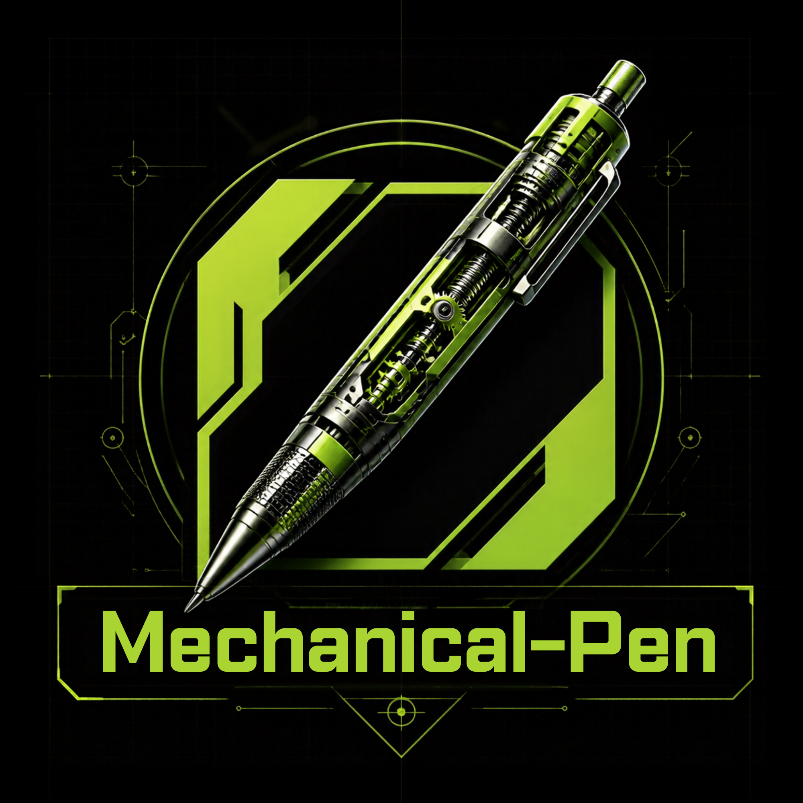
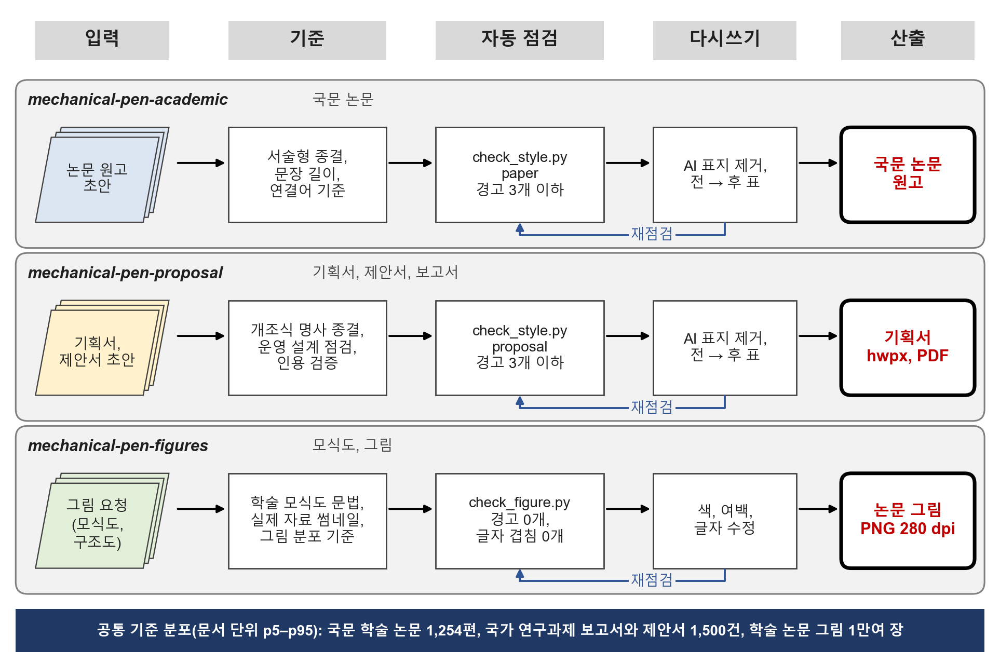

<p align="center">
  
</p>

# Mechanical Pen

Mechanical Pen은 한국어 학술 문서와 연구 그림 작업을 세 묶음으로 정리한 Claude Code 스킬 모음입니다.

| 묶음 | 대상 |
|---|---|
| `mechanical-pen-academic` | 논문, 학술 글쓰기, 학회 발표 |
| `mechanical-pen-proposal` | 기획서, 제안서, 보고서, 한글(.hwpx) 문서 |
| `mechanical-pen-figures` | 모식도, 데이터 그래프 |

글쓰기·그림 스킬 여러 개를 각 묶음의 `modules/` 아래 모듈로 모아 두었습니다. 그래서 스킬 목록에는 세 묶음만 보입니다.

AI가 쓴 공식 문서는 같은 버릇을 반복합니다.
- "~가 아니라 ~" 대비 구문, 줄표, 설명용 괄호
- 짧은 단정문을 잇달아 쓰기, 극적인 반전 문장
- 색을 채운 카드를 격자로 늘어놓은 슬라이드풍 그림

Mechanical Pen은 이런 버릇을 사람이 쓴 문서에서 잰 분포와 비교해 수치로 찾아냅니다. 초안을 쓰는 단계와 고치는 단계는 나눠서 진행합니다.



## 묶음과 모듈

### `mechanical-pen-academic`: 논문·학술 글쓰기·발표
- **묶음 본체**: 국문 논문 문체 기준(서술형 종결, 문장 길이 중앙 78자, 연결어, "본 연구" 표현), AI 표지 사례집, 인용 검증, `scripts/check_style.py --register paper`
- **모듈**

| 모듈 | 쓰는 상황 |
|---|---|
| `research-paper-writing` | 섹션 초안, 문단 흐름, 그림·표 배치 |
| `cs-academic-writing` | 문장 다듬기, 수식·알고리즘·표, 심사평 답변 |
| `claude-code-paper-writing` | 투고 전 교정·검토, 가상 심사, LaTeX 원고 감사 |
| `latex-rhythm-refiner` | LaTeX 원고의 문장·문단 리듬 조정 |
| `research-proposal` | 학위논문 계획서, 연구계획서 |
| `arxiv-paper-writer` | 리뷰(서베이) 논문, arXiv LaTeX·BibTeX 검증 |
| `academic-pptx` | 학회 발표 슬라이드, 발표 대본, 예상 질문 |
| `karpathy-article-writing` | 기술 블로그·해설 글 |

### `mechanical-pen-proposal`: 기획서·제안서·보고서·한글 문서
- **묶음 본체**
  - **본문을 쓰기 전에 개조식 / 서술식을 묻고**, 고른 형식에 따라 문체 기준·본문 구조·점검 판정을 바꿉니다.
    - 개조식: □ → ㅇ → - 명사 종결(제안서 중앙 78%), `check_style.py --register proposal`
    - 서술식: 문단과 "~한다" 종결(문장 중앙 63자), `check_style.py --register proposal_narrative`
  - 배점별 목차, 스토리텔링 구성, 운영 설계 점검표, 인용 검증
  - Word → 한글 조판 스크립트, `scripts/check_style.py --register proposal|report|summary|proposal_narrative|report_narrative`
- **모듈**

| 모듈 | 쓰는 상황 |
|---|---|
| `hwpx-editing` | 한글(.hwpx) 읽기·편집·표 추출·복구, 옛 .hwp 변환 |
| `the-fool` | 기획·계획 사전 반론(pre-mortem), 레드팀, 근거 감사 |

### `mechanical-pen-figures`: 모식도·그래프
- **묶음 본체**
  - 학술 모식도 문법: 흰 처리 상자, 파스텔 입력, 남색 모델 블록 하나, 직각 화살표, 글자 3단
  - 그림 분포 기준: 흰 여백·색 면적·캡션 길이
  - `scripts/check_figure.py`, 참조 구현 `examples/architecture_reference.py`
- **모듈**

| 모듈 | 쓰는 상황 |
|---|---|
| `sci-figure` | 투고용 데이터 그래프, 저널 크기, SVG/PDF 내보내기 |
| `scientific-visualization` | 보고서·발표용 그림, 색·대비·접근성 감사 |
| `colormaps-styling` | 색상표 선택, 색각 이상 대응 |

상황별로 묶음과 모듈을 어떤 순서로 쓰는지는 **[스킬 조합표](docs/skill-combinations.md)**에 정리했습니다.

## 공통 기준 분포
- 국문 학술 논문 1,254편, 국가 연구과제 보고서·요약문·제안서 1,500건(이 가운데 서술식 보고서 183편은 서술식 기준), 원격탐사·산림·지구과학 분야 학술 논문 그림 11,947장(이 가운데 모식도 1,692장)이 기준입니다.
- 지표마다 **문서 한 편 단위**로 값을 재고 p5–p95 범위를 기준으로 삼습니다.
- 원문은 들어 있지 않습니다. 각 묶음의 `data/` 폴더에는 백분위 수치만 있습니다.

## 작업 흐름
1. **문서 종류와 형식 정하기**: 논문, 개조식 제안서, 서술식 제안서는 종결과 문장 길이 기준이 모두 다르므로 섞지 않습니다. 제안서는 개조식·서술식을 먼저 묻습니다.
2. **초안 쓰기**: 묶음 SKILL.md의 모듈 안내표에 따라 해당 모듈의 `SKILL.md`를 읽고, 문장은 묶음의 기준 문서를 따릅니다.
3. **자동 점검**
   - 원고: 말뭉치 p95를 넘는 AI 표지와 p5–p95 밖의 구조 지표에 경고를 겁니다. **경고 3개 이하가 합격입니다.** 사람이 쓴 문서는 92–100%가 이 범위에 들고, AI 초안 기획서는 경고 17개였습니다.
   - 그림: **경고 0개, 글자 겹침 0개가 합격입니다.**
4. **다시쓰기(별도 단계)**: 경고가 난 문장을 한 문장씩 고칩니다. 수치·인용·주장 범위는 그대로 둡니다.
5. **재점검과 보고**: 경고 수가 어떻게 바뀌었는지, 문장이 어떻게 고쳐졌는지 "전 → 후" 표로 남깁니다.

## 설치

```bash
git clone https://github.com/tradeprogram/Mechanical-Pen.git
```

```bash
cp -r Mechanical-Pen/skills/* ~/.claude/skills/
```

- Windows에서는 가장 긴 파일 경로가 저장소 기준 171자입니다. 깊은 폴더에 받으면 경로 길이 제한(260자)에 걸릴 수 있으니, 바탕화면처럼 짧은 경로에 받거나 아래 설정을 켠 뒤 받습니다.

```bash
git config --global core.longpaths true
```

- Claude Code를 다시 시작하면 세 묶음이 스킬 목록에 나타납니다. 모듈은 목록에 따로 나오지 않고, 묶음이 필요할 때 읽어 씁니다.
- 같은 이름의 스킬(예: `research-paper-writing`)을 이미 따로 설치해 두었다면 지워야 같은 스킬이 두 번 잡히지 않습니다.

필요한 패키지:

```bash
pip install pymupdf python-docx lxml numpy pillow matplotlib
```

- 한글 변환·조판 스크립트(`hwpx-editing`의 .hwp 변환, `docx2hwpx.py`, `merge_hwpx.py`)는 Windows의 한글 프로그램과 `pywin32`가 있어야 돌아갑니다.
- 모듈마다 추가로 필요한 패키지가 있으면 그 모듈의 `SKILL.md`에 적혀 있습니다.
- [스킬 조합표](docs/skill-combinations.md)에서 `(별도 설치)`로 표시한 외부 스킬은 이 저장소에 없습니다. 없으면 그 단계만 건너뜁니다.

## 점검 명령

```bash
python -X utf8 ~/.claude/skills/mechanical-pen-academic/scripts/check_style.py 원고.docx --register paper
```

```bash
python -X utf8 ~/.claude/skills/mechanical-pen-proposal/scripts/check_style.py 기획서.pdf --register proposal
```

```bash
python -X utf8 ~/.claude/skills/mechanical-pen-proposal/scripts/check_style.py 서술식_제안서.docx --register proposal_narrative
```

```bash
python -X utf8 ~/.claude/skills/mechanical-pen-figures/scripts/check_figure.py 그림.png --kind schematic --target kr
```

- `check_style.py`는 `.pdf`, `.docx`, `.hwpx`, `.txt`, `.md`를 읽습니다. PDF에서 뽑은 텍스트 파일이면 `--as-pdf-text`를 붙입니다.
- `check_figure.py`의 `--kind`는 `schematic`, `study_area`, `map`, `plot` 중 하나입니다. `--target`은 국제 학술지(`intl`)와 국문 학술지(`kr`) 중 하나입니다.
- 두 스크립트 모두 경고가 합격선을 넘으면 종료코드 1을 돌려줍니다.

## 저장소 구조

```
skills/
  mechanical-pen-academic/
    SKILL.md                 묶음 본체 + 모듈 안내표
    references/ scripts/ data/
    modules/                 research-paper-writing, cs-academic-writing, claude-code-paper-writing,
                             latex-rhythm-refiner, research-proposal, arxiv-paper-writer,
                             academic-pptx, karpathy-article-writing
  mechanical-pen-proposal/
    SKILL.md  references/ scripts/ data/
    modules/                 hwpx-editing, the-fool
  mechanical-pen-figures/
    SKILL.md  references/ scripts/ data/ examples/ LICENSE
    modules/                 sci-figure, scientific-visualization, colormaps-styling
docs/
  architecture.png           위 아키텍처 그림 (examples/architecture_reference.py로 생성)
  skill-combinations.md      스킬 조합표
```

## 라이선스와 원저작자

모듈과 그림 묶음의 바탕 코드는 아래 원저작자의 공개 스킬입니다. 각 폴더의 `LICENSE` 파일을 그대로 두었으니, 옮기거나 배포할 때 함께 두어야 합니다.

| 위치 | 라이선스 | 저작권자 |
|---|---|---|
| `mechanical-pen-figures/` 바탕 스킬 | MIT | sai-tv |
| `academic/modules/research-paper-writing` | MIT | Master-cai |
| `academic/modules/cs-academic-writing` | MIT | Rex |
| `academic/modules/claude-code-paper-writing` | MIT | jeff8384 |
| `academic/modules/latex-rhythm-refiner` | MIT | appautomaton |
| `academic/modules/arxiv-paper-writer` | MIT | appautomaton |
| `academic/modules/research-proposal` | MIT | luwill (research-skills) |
| `academic/modules/academic-pptx` | MIT | Gabberflast |
| `academic/modules/karpathy-article-writing` | MIT | Irteza |
| `proposal/modules/hwpx-editing` | MIT | hwpx-editing-skill contributors |
| `proposal/modules/the-fool` | MIT | Jeffallan |
| `figures/modules/sci-figure` | MIT | sci-figure contributors |
| `figures/modules/scientific-visualization` | MIT | K-Dense Inc. |
| `figures/modules/colormaps-styling` | BSD 3-Clause | HoloViz Community |

여러 모듈에는 국문 원고 안내, 발표 문체 규칙, 묶음 경로 같은 내용을 덧붙였습니다. 원래 내용과 라이선스 고지는 그대로 남아 있습니다.
